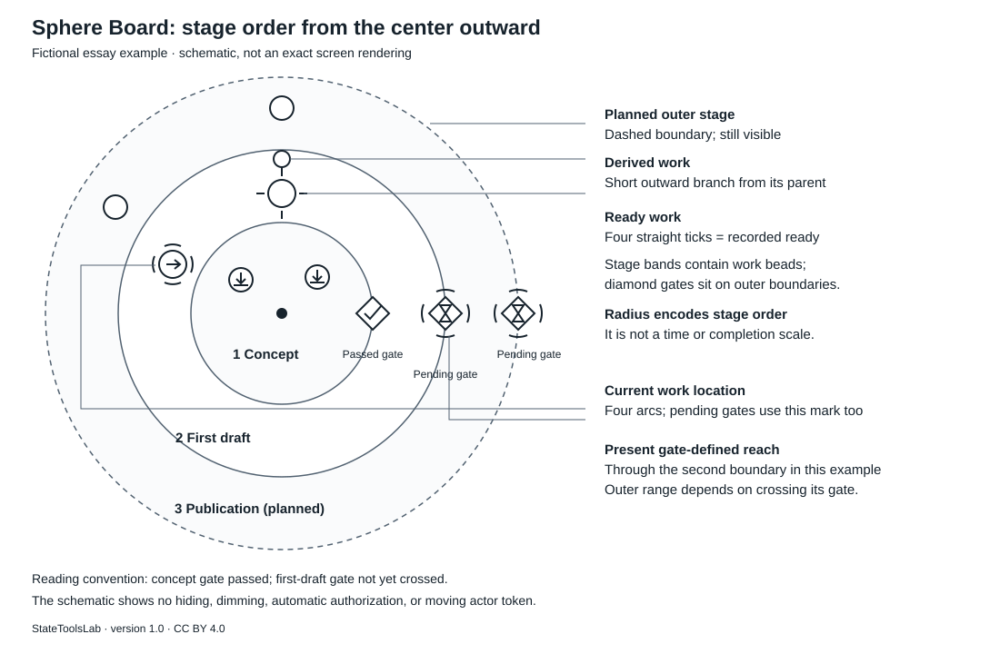

# Sphere Board

**v0.6.0**

Sphere Board（スフィアボード）は、台帳や計画の `map.json` を、見るだけの **Sphere Board** として描くためのビューアです。Sphere Board から計画事実を編集しません。同梱ビューアは `sphere-starter/0.3` の map を読み、ノード、現在地、Ready、関係、ゲート、レーン、テーマを表示します。



*[短い論文](docs/paper/)の図 1（CC BY 4.0）。模式図で、画面の写しではありません。*

## どう作ったか

Sphere Board（スフィアボード）は、StateToolsLab が AI の支援を受けて作っています。設計の対話、実装、文書と短い論文の下書きを、AI（ChatGPT〔OpenAI〕と Claude〔Anthropic〕）と分担しました。要件を決め、各段階のゲートで判断し、版ごとに試験・チェックサム・計画の台帳と照らして受け入れるのは人です。AI が提案し、人が確かめて決める、という同じ分担を、map を更新するときのやり方として [docs/ai-workflow.md](docs/ai-workflow.md) にも書いています。

## 動かし方

ビルド済みの英語版は `index.html`、日本語版は `ja/index.html` です。どちらも単体で動きます。ブラウザーで直接開き、**map.json を開く**（英語版は **Open map.json**）から Starter の map を選べます。同梱の見本は各画面の言語で、どれも架空です。画面内の言語切替はありません。どちらの画面でも英日いずれの map もそのまま読めます。

ローカルサーバーと自動再読込を使う場合は Node.js 22 以上を使います。

```sh
node tools/sphere.mjs serve --map examples/essay.json --port 8787
```

英語版は `http://127.0.0.1:8787/`、日本語版は `http://127.0.0.1:8787/ja/` を開いてください。どちらも `--map` で選んだ同じ map を表示します。日本語の見本を表示する場合は `--map examples/ja/essay.json` を指定します。`init` で作ったプロジェクトでは `.sphere/sphere.mjs serve` を使い、同じ URL の末尾で英日を選べます。npm install、CDN、API キー、実行時パッケージ依存は不要です。`package.json` の `private: true` は維持しており、パッケージレジストリへの配信は対象外です。

## map.json の形と書き方

Starter の map は `profile: "sphere-starter/0.3"` を持ち、プロジェクト情報、actors、nodes、relations、regions、currents、lanes と任意の layout を記録します。まず [map.json の手引き](docs/map-json-guide.md)、[Starter 形式の説明](spec/starter-map.md)、[JSON Schema](spec/starter-map.schema.json) を参照してください。

AI に計画から Starter の map を作らせる場合は [prompts/plan-to-map.md](prompts/plan-to-map.md) を使えます。不明な事実を補わず、未確定のまま残すための指示を含みます。

## 見るだけの盤とテーマ

hover、選択、Esc、空所クリック、パン、ズーム、一覧表示、テーマ切替は、読み込んだ map を書き換えません。状態は固定の形、レーンは色で表します。World は Core Plain を同梱し、Brand の Example Studio は架空のサンプルです。

## 論文

Sphere Board（スフィアボード）の考え方を説明する短い論文を [`docs/paper/`](docs/paper/) に置いています（英語版と日本語版、版 1.1、改訂 2026-10-18、初版 1.0 は 2026-10-17、CC BY 4.0）。

## ビルドと試験

```sh
node tools/build.mjs
node tools/build.mjs --check
node --test tests/*.test.cjs
node tools/verify-release.mjs
```

開発用のブラウザー試験では、利用できる場合に Python・Playwright・Chromium を使います。ビューアの実行時依存ではありません。

v0.6.0 は Linux 上の Node.js 24、Python 3.12、Playwright 1.57、Chromium 153 で確認しました。既存の Node 試験を含む全件と、英日の smoke・layout・finish ブラウザー試験を通過しました。実際の `file:` URL とローカル HTTP サーバー経由の表示も確認済みです。論文・ライセンス・旧画面写真・形・配置・スキーマは保持しています。詳細は [verification/TEST_REPORT.md](verification/TEST_REPORT.md)、今回の画面写真は [preview/v0.6.0/](preview/v0.6.0/) にあります。この版の Firefox・Safari・実機のスマートフォン・公開ホスティングは未検証です。

状態・ゲート・表示用語の対訳と選定理由は [docs/viewer-terminology.md](docs/viewer-terminology.md)、共通ロジックと英日表示ソースの構成は [docs/architecture.md](docs/architecture.md) に記載しています。

## ライセンス

- コードおよび `docs/paper/` 以外のリポジトリ内容: [MIT License](LICENSE)。Copyright (c) 2026 StateToolsLab。
- [`docs/paper/`](docs/paper/) の文章: [Creative Commons Attribution 4.0 International (CC BY 4.0)](docs/paper/LICENSE)。Copyright (c) 2026 StateToolsLab。
